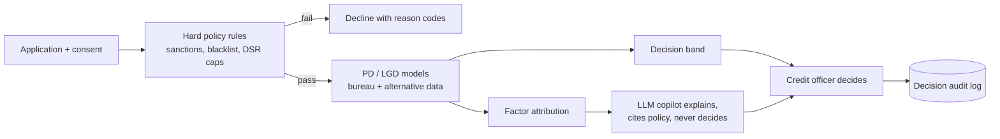

# RLens documentation

> Status: AUTHORED · Updated 2026-09-23 · Owner: Ossama Mokhtar

RLens is a **reference architecture plus a clickable UI prototype** for explainable credit scoring of thin-file GCC borrowers. The UI runs on sample data. Models, AML screening and the copilot are specified here, not built. Every document says which of those two it is in its status line.

## Start here

| # | Document | What it answers | Status |
|---|---|---|---|
| 00 | [Status](00-status.md) | What exists today versus what is designed | Authored |
| 01 | [System architecture](01-system-architecture.md) | Services, event bus, data layer, integrations | Spec |
| 02 | [Data model](02-data-model.md) | Entities and relationships (`database/schema.sql`) | Spec |
| 03 | [API endpoints](03-api-endpoints.md) | Service contracts | Spec |
| 04 | [ML pipeline](04-ml-pipeline.md) | Features, training, calibration, drift, policy rules | Spec |
| 05 | [LLM / RAG architecture](05-llm-rag-architecture.md) | Copilot, retrieval, access control, guardrails | Spec |
| 06 | [User journeys and wireframes](06-user-journeys-wireframes.md) | Officer, SME applicant, risk analyst flows | Spec |
| 07 | [Scoring logic](07-scoring-logic.md) | How a decision is reached: grades, affordability, decision tree | Spec |
| 08 | [Security and deployment](08-security-deployment.md) | Controls, environments, residency, cost | Spec |
| 09 | [UI/UX design system](09-ui-ux-design-system.md) | Components and patterns | Spec |
| 10 | [Bilingual tone pack](10-bilingual-tone-pack.md) | AR/EN voice, RTL rules | Spec |
| 11 | [Fintech UX elevation spec](11-fintech-ux-elevation-spec.md) | Interaction quality bar | Spec |
| 12 | [Regulatory positioning](12-regulatory-positioning.md) | Decisioning system or decision support? | Draft |
| 13 | [Decision log](13-decision-log.md) | ADRs with rejected options and reversal triggers | Authored |
| 14 | [Evaluation and fairness plan](14-evaluation-and-fairness.md) | What "good" means before any model ships | Authored |
| — | [GAPS](GAPS.md) | Ranked list of what is open | Authored |

## How the pieces fit

The rule that governs the whole design: **deterministic rules and the credit officer decide; models estimate; the LLM explains.** See [ADR-001](13-decision-log.md#adr-001-the-llm-explains-it-never-scores-or-decides).

## Docs quality gate

`scripts/check-docs.sh` runs in CI: every relative link resolves, every Mermaid block is closed, every numbered doc carries a `> Status:` line.
